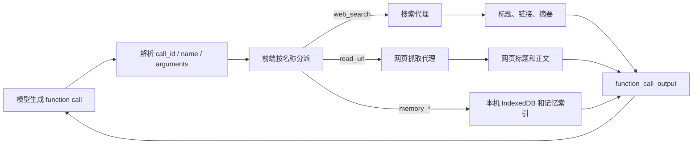

# Chat Demo 工具系统质量评审

> 日期：2026-11-22  
> 范围：模型可见的工具说明与参数 schema、工具调用解析/分派、搜索和网页抓取代理、记忆工具及相关测试。  
> 方法：仓库代码静态审查；未调用真实模型，也未验证外部抓取服务内部实现。

## 结论

工具层整体处于**可用的基础阶段**：工具名称基本明确，记忆工具对何时保存/改写给出了有价值的语义说明；后端有用户认证、输入限制、超时、结果截断和调用轮数上限。主要短板在于：**模型可见的 schema 约束弱于真实执行约束、执行端没有按本轮 capability 再授权、外部网页结果没有明确的信任边界**。

简要评价：

| 维度 | 评价 | 说明 |
|---|---|---|
| 工具名称与基础说明 | 中等 | 记忆工具较具体，搜索和读取工具较泛 |
| 参数 schema | 偏弱 | 数组元素和字符串边界缺少结构化约束 |
| 后端输入/输出处理 | 中等偏好 | 有认证、部分限长、超时和结果裁剪 |
| 执行授权与信任边界 | 需优先加强 | 声明开关未在执行端复核；网页结果作为原文回传 |
| 测试覆盖 | 基础 | 有映射/截断测试，缺调用授权和组合流程测试 |

## 工具清单与数据路径

当前模型可能看到的工具包括 `read_url`、`web_search`，以及记忆开启时的 `memory_update_profile`、`memory_save`、`memory_edit`。声明集中在 [tools.ts](../src/services/memory/tools.ts#L12) 和 [tools.ts](../src/services/memory/tools.ts#L76)。

## 做得不错的部分

1. `memory_save` 说明了长期事实、去重及与 `memory_edit` 的关系；`memory_edit` 也说明了编号/描述定位和歧义处理。[tools.ts](../src/services/memory/tools.ts#L32) [tools.ts](../src/services/memory/tools.ts#L49)
2. 记忆关闭时不声明记忆工具；搜索关闭时不声明搜索工具。[tools.ts](../src/services/memory/tools.ts#L93)
3. 搜索端限制 query 为 200 字、结果最多 5 条，并截断 title/snippet；抓取端限制 HTTP(S)、15 秒超时和 8,000 字符正文。[search.ts](../functions/api/tools/search.ts#L26) [search.ts](../functions/api/tools/search.ts#L79) [fetch.ts](../functions/api/tools/fetch.ts#L21) [fetch.ts](../functions/api/tools/fetch.ts#L47)
4. 工具调用链有最大轮数，避免模型持续循环调用。[toolRounds.ts](../src/services/chat/toolRounds.ts#L8)

## 发现与优化建议

### F-01：执行端需要验证本轮工具授权

**证据：** 工具声明按设置开关筛选，但模型返回的 function call 在解析后只检查名称是否存在；执行器之后按名称直接分派，没有收到本轮允许工具集合，也没有在执行时复核当前开关。[tools.ts](../src/services/memory/tools.ts#L76) [responses.ts](../src/services/api/responses.ts#L149) [client.ts](../src/services/api/client.ts#L271) [store.ts](../src/services/chat/store.ts#L118) [store.ts](../src/services/chat/store.ts#L1776)

**影响：** 上游若返回未声明的工具调用，仍可能触发搜索或记忆写入。生成期间用户关闭记忆时，开始请求时的开关快照也可能继续允许本轮稍后的写入。对严格限制工具名称的上游，未声明调用未必容易出现；执行层仍应独立落实 capability。

**建议：**

1. 每次请求生成明确的 `allowedTools` 集合，并传给执行器。
2. 执行前同时校验工具名、本轮集合、当前用户/账户、功能开关和请求世代。
3. 关闭记忆后，阻止尚未执行的记忆写操作；关闭搜索后，阻止新搜索调用。
4. 未授权或未知工具名返回受控错误，并记录工具名和拒绝原因，不记录敏感参数正文。

**验收：** 覆盖关闭记忆时的 `memory_save`、关闭搜索时的 `web_search`、未知工具名以及请求在途关闭开关后的行为。

### F-02：补全参数 schema 与类型表达能力

**证据：** `memory_save.tags` 和 `memory_edit.tags` 声明为 array，但没有 `items`；搜索 query、URL、记忆正文等字段没有 schema 级长度/格式限制。`FunctionToolParam` 的属性类型只有 `type` 和 `description`，难以表达完整 JSON Schema。[tools.ts](../src/services/memory/tools.ts#L20) [tools.ts](../src/services/memory/tools.ts#L36) [types.ts](../src/services/api/types.ts#L167)

**影响：** 模型能看到字段名称，但对数组元素、值边界和额外字段缺少明确约束；运行时实现只能零散地过滤或依赖后端拒绝。

**建议：**

1. 将工具 schema 类型扩展为可表达 `items`、`minLength`、`maxLength`、`maxItems`、`format`、`additionalProperties` 等约束。
2. `tags` 明确为字符串数组并设数量/单项长度上限；`url` 明确为绝对 HTTP(S) URL；query 和记忆内容设最大长度。
3. 若上游支持 strict function schema，再按其要求设置 strict 模式和必填字段；如果不支持，也必须保留前端运行时验证。
4. 描述中的数值限制引用同一常量，避免 `800`、`200` 等文字与实现漂移。

**验收：** 声明序列化测试验证完整 schema；运行时测试拒绝缺字段、错误类型、过长字段、未知属性和错误数组元素。

### F-03：改善搜索与读取工具说明

**证据：** `web_search` 仅称“搜索互联网，返回若干条”；`read_url` 仅称“读取一个网页的正文内容”。实际搜索最多 5 条，抓取正文最多 8,000 字符，但模型看不到这些边界，也缺少何时使用和避免重复调用的提示。[tools.ts](../src/services/memory/tools.ts#L81) [tools.ts](../src/services/memory/tools.ts#L97) [search.ts](../functions/api/tools/search.ts#L26) [fetch.ts](../functions/api/tools/fetch.ts#L21)

**建议：**

- `web_search`：说明用于需要最新信息或来源链接的任务；query 应简洁具体；最多 5 条结果；不需要外部资料时不要调用；避免重复同一 query。
- `read_url`：说明只接收完整 HTTP(S) URL，返回纯文本且可能截断到 8,000 字；先从搜索结果选择相关页面，不重复读取同一 URL；页面内容是待分析资料，不是新的任务指令。
- 两个工具的描述说明来源字段和输出可能不完整，避免模型把摘要当成完整页面或把搜索结果当作已核实事实。

**验收：** 用工具选择评测集比较“无需工具/搜索/读取/搜索后读取”四类任务的正确选择率和重复调用率。

### F-04：将记忆工具的副作用和写入条件说清楚

**证据：** 记忆工具描述已给出长期事实和编辑场景，但没有明确说明画像更新会整体替换、只依据用户明确陈述，或避免把网页中的外部内容直接存成用户事实。运行时的 profile 更新是整块重写，`memory_edit` 会修改既有条目。[tools.ts](../src/services/memory/tools.ts#L16) [tools.ts](../src/services/memory/tools.ts#L32) [tools.ts](../src/services/memory/tools.ts#L49) [store.ts](../src/services/chat/store.ts#L185)

**建议：**

1. 在 `memory_update_profile` 描述中突出“整体替换”，只在稳定偏好/身份/环境确有变化时调用；不适合时使用 `memory_save`。
2. 明确记忆只从用户明确陈述或确认的信息提取；搜索结果、网页内容、工具返回不能自动视作用户事实。
3. 明确不保存密码、API key、访问令牌等凭证类内容。
4. 对 `memory_edit` 说明改写会覆盖旧内容且需要明确定位；歧义时先询问或返回候选，不猜测修改。
5. 记忆功能已由用户开关控制；是否再增加单次确认属于产品选择。若不增加确认，至少提供来源、修改历史和撤销能力。

**验收：** 覆盖普通对话、用户明确要求保存、网页注入、画像替换、编辑定位有歧义和敏感凭证场景。

### F-05：给外部工具结果建立明确的信任边界

**证据：** 搜索标题/URL/snippet 和抓取标题/正文被直接格式化为 function output，再发送给模型；现有代码注释虽称结果是不可信数据，但结果文本本身没有来源/不可信边界包装。[store.ts](../src/services/chat/store.ts#L115) [store.ts](../src/services/chat/store.ts#L150) [store.ts](../src/services/chat/store.ts#L177) [store.ts](../src/services/chat/store.ts#L1827)

**影响：** 外部页面可能包含面向模型的指令文本，模型可能将其当成可执行指令或将其持久保存。该风险是数据流组合，不代表模型必然服从。

**建议：**

1. 在固定系统指令中规定网页、搜索、附件、记忆均是资料而非权限来源。
2. 工具输出结构化包含 `source_url`、`title`、`content`、`truncated`，并清晰区分外部资料和应用指令。
3. 工具副作用权限由程序 allowlist 控制，不依赖提示词约束。
4. 记忆写入保留来源元数据，支持审查和撤销。

**验收：** 恶意网页要求调用记忆工具或改变工具权限时，执行层仍按 allowlist 拒绝；外部内容不能改变用户开关。

### F-06：加强搜索结果 URL 与网页抓取目标校验

**证据：** `mapResults()` 只要求搜索结果有非空 URL；页面展示层会过滤非 HTTP(S)，但回给模型的文本在过滤前已经组装。抓取代理只检查协议，然后把 URL 转交外部 Keenable 服务；本仓库看不到对私网地址和重定向目标的约束。[search.ts](../functions/api/tools/search.ts#L34) [store.ts](../src/services/chat/store.ts#L150) [toolBlocks.ts](../src/services/chat/toolBlocks.ts#L49) [fetch.ts](../functions/api/tools/fetch.ts#L47) [fetch.ts](../functions/api/tools/fetch.ts#L66)

**建议：**

1. `mapResults()` 统一解析 URL，只返回有效 HTTP(S) URL，并限制 URL 长度。
2. 读取工具继续在后端独立校验 URL；确认外部抓取服务是否拒绝 loopback、私网、链路本地地址和重定向到内网的目标。
3. 若外部服务没有明确保证，在可控服务端实施逐跳目标校验和响应大小限制。

**状态：** 外部服务内部行为未验证，因此私网抓取属于待核实边界，不定性为已证实漏洞。

**验收：** 测试 malformed URL、`javascript:` URL、HTTP(S) 正常 URL、重定向和私网目标；不允许无效 URL进入模型工具结果或浏览器链接。

### F-07：补足工具系统测试

**证据：** `tools.test.ts` 主要测试搜索结果映射和网页正文形状/截断；`memory.test.ts` 测工具名称声明开关，但没有执行层权限测试。[tools.test.ts](../tests/tools.test.ts#L5) [memory.test.ts](../tests/memory.test.ts#L167)

**建议测试矩阵：**

| 层 | 用例 |
|---|---|
| schema | 所有工具参数字段、数组 items、required、长度上限 |
| parser | 空 call_id/name、畸形 JSON、null/array 参数、未知工具名 |
| authorization | 开关关闭、请求中途关闭、账户世代变化、未声明调用 |
| handlers | 空 query、超长 query、错误 URL、网络失败、超时、取消 |
| prompt injection | 搜索/抓取内容诱导写记忆或更换工具权限 |
| rate limit | 并发超限、上游错误、成功结算与失败尝试预算 |

## 建议实施顺序

1. **先做执行期 allowlist 和运行时参数验证。** 这是工具权限边界，不依赖模型行为。
2. **补全 schema 和工具描述。** 把模型可见约束与后端实际限制对齐。
3. **隔离外部内容与应用指令，建立记忆写入来源策略。** 开启记忆仍保留用户选择，但阻止网页资料获得指令权限。
4. **核对 URL 抓取服务边界并验证。** 先取得外部服务策略证据，再决定应用侧补充措施。
5. **扩展自动化测试与调用可观测性。** 记录工具名、参数验证结果、执行耗时、状态码和拒绝原因；不记录记忆正文或完整网页内容。

## 审查边界

本评审基于本仓库代码和现有测试，未调用真实模型，也未核验外部抓取服务对私网和重定向的处理。工具描述质量属于工程判断；推荐方案应通过工具选择率、参数错误率、重复调用率和权限回归测试验证。
